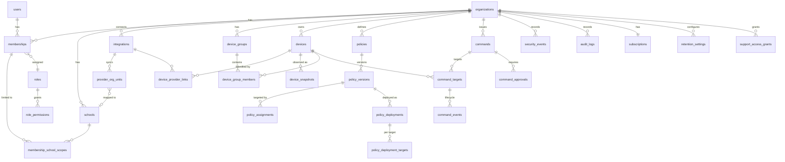

# Data Model

> **Status:** Proposed. This is a design for review, not a migration. Column lists are indicative; exact types, indexes, and constraints are finalized in M1–M3 migrations with tests.

## 1. Conventions

- **Primary keys:** `uuid` (UUIDv7 preferred for index locality), column `id`.
- **Tenant key:** every tenant-scoped table has `organization_id uuid not null references organizations(id)`.
- **Composite foreign keys for tenant safety:** child tables reference parents with `(organization_id, parent_id)` → parent's `unique (organization_id, id)`. This makes cross-tenant references impossible at the schema level, not just by convention.
- **Timestamps:** `created_at timestamptz not null default now()`, `updated_at timestamptz` where mutable. All times UTC.
- **Soft state, not soft delete:** records have explicit lifecycle status columns; hard deletion is performed by retention/deletion jobs and recorded.
- **Enums:** PostgreSQL `text` with `check` constraints (easier to evolve than native enums).
- **Provider data:** provider identifiers are stored in dedicated columns; raw payloads in `jsonb` only where needed for provenance, with retention.
- **No student PII in free-text fields** controlled by the system (logs, error messages).

## 2. Entity overview



## 3. Entities

### 3.1 Tenancy and identity

**`organizations`** (tenant root; not RLS-scoped by `organization_id` but by `id`)
| Column | Notes |
| --- | --- |
| `id` | PK |
| `name`, `slug` | `slug` unique |
| `status` | `active`, `suspended`, `offboarding`, `deleted` |
| `is_demo` | `boolean`; demo tenants render a "simulated data" banner and may never connect to real providers |
| `data_region` | e.g. `us` |
| `created_at` | |

**`schools`**
`id`, `organization_id`, `name`, `external_ref` (e.g. state school ID, optional), `status`.

**`users`** (global identity; one row per human)
`id`, `auth_subject` (IdP subject, unique), `email`, `display_name`, `status`, `last_login_at`. Contains no role information.

**`memberships`** (user ↔ organization)
`id`, `organization_id`, `user_id`, `role_id`, `status` (`invited`, `active`, `suspended`, `removed`), `invited_by`, `mfa_required boolean`. Unique `(organization_id, user_id)`.

**`membership_school_scopes`**
`organization_id`, `membership_id`, `school_id`. If no rows exist the membership is organization-wide (only allowed for roles flagged `org_wide_allowed`).

**`roles`** / **`permissions`** / **`role_permissions`**
- `permissions`: static catalog seeded by migrations (`device.read`, `command.issue.reboot`, `command.approve`, `policy.write`, `audit.read`, `audit.export`, `integration.manage`, `member.manage`, `remote_access.start`, …).
- `roles`: `id`, `organization_id NULL` (NULL = built-in system role), `key`, `name`, `org_wide_allowed`.
- Custom roles are post-MVP; the schema supports them.

**`support_access_grants`**
`id`, `organization_id`, `granted_to_user_id` (SchoolOS staff), `granted_by_membership_id`, `scope` (`read_only`, `read_write`), `reason`, `ticket_ref`, `starts_at`, `expires_at`, `revoked_at`. Checked by the authorization layer; every use is audited.

### 3.2 Integrations

**`integrations`**
| Column | Notes |
| --- | --- |
| `id`, `organization_id` | |
| `provider` | `google_workspace` (MVP); `schoolos_agent` (future) |
| `external_customer_id` | Google customer ID (e.g. `my_customer` is **not** stored; the resolved ID is) |
| `auth_method` | depends on outcome of CHROMEOS_INTEGRATION open questions (`oauth_admin_consent`, `service_account_dwd`, …) |
| `credential_ref` | pointer to the encrypted secret (secrets manager key or envelope-encrypted row in `integration_credentials`); never the secret itself |
| `granted_scopes` | `text[]` as reported by the provider |
| `status` | `pending`, `active`, `error`, `revoked` |
| `last_sync_at`, `last_error_code`, `last_error_at` | |

**`integration_credentials`** (only if not using an external secrets manager per tenant)
`integration_id`, `organization_id`, `ciphertext bytea`, `wrapped_dek bytea`, `kek_id`, `created_at`, `rotated_at`. Readable only by a dedicated DB role used by workers.

**`provider_org_units`**
`id`, `organization_id`, `integration_id`, `provider_org_unit_id` (Google `orgUnitId`, immutable), `path` (Google `orgUnitPath`, mutable), `parent_provider_org_unit_id`, `mapped_school_id NULL`, `last_seen_at`.

**`sync_runs`**
`id`, `organization_id`, `integration_id`, `kind` (`devices_full`, `devices_incremental`, `org_units`, `policy_resolve`), `status`, `started_at`, `finished_at`, `items_seen`, `items_changed`, `error_summary`.

### 3.3 Devices

**`devices`** (SchoolOS's platform-neutral device record)
| Column | Notes |
| --- | --- |
| `id`, `organization_id` | |
| `school_id NULL` | derived from org-unit mapping or set manually |
| `platform` | `chromeos`, `schoolos_linux`, `linux` |
| `serial_number` | unique per `(organization_id, serial_number)` where present |
| `asset_tag` | |
| `display_name` | |
| `lifecycle_status` | SchoolOS-level: `active`, `lost`, `retired`, `removed_from_provider` |
| `provider_status` | last provider-reported status (e.g. Google `ACTIVE`, `DISABLED`, `DEPROVISIONED`); never set by SchoolOS intent |
| `provider_status_observed_at` | |
| `os_version`, `model` | latest observed |
| `last_seen_at` | from provider `lastSync` or agent heartbeat |
| `assigned_user_ref NULL` | see privacy notes; for ChromeOS this is the admin-annotated user, not tracked logins |

**`device_provider_links`**
`organization_id`, `device_id`, `integration_id`, `provider`, `provider_device_id` (Google `deviceId`), unique `(integration_id, provider_device_id)`.

**`device_snapshots`** (observed state history; time-partitioned when needed)
`id`, `organization_id`, `device_id`, `source` (`google_directory`, `google_telemetry`, `agent`), `observed_at`, `attributes jsonb` (minimized allow-listed fields only), `raw_ref NULL` (object storage pointer, short retention).

**`device_groups`** / **`device_group_members`**
Static groups in MVP: `device_groups(id, organization_id, school_id NULL, name, kind)`; membership rows. Dynamic (rule-based) groups are later.

**`device_enrollments`** (future, native agent)
`id`, `organization_id`, `device_id`, `enrollment_token_id`, `public_key`, `certificate_serial`, `certificate_not_after`, `status` (`active`, `revoked`), `revoked_reason`.

**`enrollment_tokens`** (future)
`id`, `organization_id`, `school_id NULL`, `token_hash` (never plaintext), `expires_at`, `max_uses`, `uses`, `created_by`.

### 3.4 Policies

**`policies`**: `id`, `organization_id`, `name`, `description`, `status` (`draft`, `active`, `archived`).

**`policy_versions`** (immutable once published)
`id`, `organization_id`, `policy_id`, `version int`, `settings jsonb` (keys must exist in the code-defined setting catalog), `published_by`, `published_at`, `checksum`.

**`policy_assignments`**
`id`, `organization_id`, `policy_id`, `scope_type` (`organization`, `school`, `device_group`), `scope_id`, `priority`, `active`.

**`policy_deployments`**
`id`, `organization_id`, `policy_version_id`, `requested_by`, `status` (`queued`, `running`, `completed`, `completed_with_errors`, `failed`), `started_at`, `finished_at`.

**`policy_deployment_targets`**
`id`, `organization_id`, `policy_deployment_id`, `platform`, `provider_target_ref` (e.g. Google org unit ID), `setting_key`, `result` (`applied`, `unchanged`, `not_applicable`, `failed`), `provider_response_ref`, `error_message`.

**`policy_drift_observations`**
`id`, `organization_id`, `provider_target_ref`, `setting_key`, `intended_value jsonb`, `observed_value jsonb`, `observed_at`, `resolved_at`.

### 3.5 Commands

**`commands`** (one per request; may target many devices)
| Column | Notes |
| --- | --- |
| `id`, `organization_id` | |
| `type` | SchoolOS command type (`reboot`, `disable`, `reenable`, `wipe_users`, `powerwash`, `start_remote_session`, …) |
| `parameters jsonb` | validated per type |
| `reason` | required free text (staff-authored; guidance not to include student details) |
| `requested_by_membership_id` | |
| `approval_policy` | snapshot of policy at request time |
| `status` | approval states plus aggregate of targets: `requested`, `pending_approval`, `approved`, `in_progress`, `completed`, `completed_with_errors`, `rejected`, `cancelled` |
| `expires_at` | |
| `idempotency_key` | unique per organization |
| `is_remote_access` | boolean, for audit filtering |

**`command_approvals`**
`id`, `organization_id`, `command_id`, `approver_membership_id`, `decision` (`approved`, `rejected`), `comment`, `decided_at`. Check constraint + service rule: approver ≠ requester.

**`command_targets`** (per-device execution)
`id`, `organization_id`, `command_id`, `device_id`, `provider`, `provider_command_ref NULL` (e.g. Google `commandId`), `status` (lifecycle in SYSTEM_ARCHITECTURE §10), `last_provider_state`, `result_payload_ref NULL`, `error_message NULL`, `updated_at`.

**`command_events`** (append-only lifecycle)
`id`, `organization_id`, `command_target_id`, `from_status`, `to_status`, `actor_type` (`user`, `system`, `provider`, `device`), `actor_id NULL`, `provider_state NULL`, `details jsonb`, `occurred_at`. `UPDATE`/`DELETE` revoked.

**`command_signatures`** (future, native agent)
`command_target_id`, `organization_id`, `key_id`, `nonce`, `issued_at`, `not_after`, `signature bytea`.

### 3.6 Security events

**`security_events`**
| Column | Notes |
| --- | --- |
| `id`, `organization_id` | |
| `rule_id`, `rule_version` | deterministic rule that produced it |
| `source` | `google_directory_sync`, `google_policy_drift`, `schoolos_auth`, `schoolos_extension`, `agent` |
| `severity` | `info`, `low`, `medium`, `high`, `critical` |
| `entity_type`, `entity_id` | e.g. `device`, `membership`, `integration` |
| `summary` | system-generated, no student PII |
| `evidence jsonb` | minimized fields supporting the event |
| `dedupe_key`, `first_seen_at`, `last_seen_at`, `occurrence_count` | |
| `triage_status` | `new`, `acknowledged`, `in_progress`, `resolved`, `dismissed` |
| `assigned_to_membership_id NULL` | |

**`security_event_notes`**: `id`, `organization_id`, `security_event_id`, `author_membership_id`, `body`, `created_at`.

### 3.7 Audit logs

**`audit_logs`** (append-only, hash-chained per organization)
| Column | Notes |
| --- | --- |
| `id`, `organization_id NULL` | NULL only for platform-level events |
| `seq bigint` | monotonically increasing per organization |
| `occurred_at` | |
| `actor_type` | `user`, `support`, `system`, `provider`, `device` |
| `actor_id`, `actor_ip`, `actor_user_agent` | |
| `action` | e.g. `command.requested`, `command.approved`, `policy.published`, `member.role_changed`, `integration.connected`, `audit.exported`, `support.access_used` |
| `target_type`, `target_id` | |
| `outcome` | `success`, `denied`, `error` |
| `metadata jsonb` | no secrets, minimized PII |
| `correlation_id` | |
| `prev_hash`, `hash` | `hash = H(prev_hash ‖ canonical(row))` |

Rules: `app_user` has `INSERT` and `SELECT` only. Writes go through a single function to keep `seq`/hash computation consistent (serialized per organization via advisory lock). A scheduled job verifies the chain and alerts on mismatch. Periodic anchoring of the latest hash to external write-once storage is planned.

### 3.8 Subscriptions

**`subscriptions`**
`id`, `organization_id` (unique), `plan_key`, `status` (`trial`, `active`, `past_due`, `cancelled`, `expired`), `device_seat_limit`, `term_start`, `term_end`, `billing_provider NULL`, `billing_customer_ref NULL`, `contract_ref NULL` (e.g. signed DPA reference).

**`subscription_usage_snapshots`**: `organization_id`, `snapshot_date`, `active_device_count`.

### 3.9 Privacy and retention

**`retention_settings`**
`organization_id`, `data_category` (`device_snapshots`, `security_events`, `command_events`, `audit_logs`, `raw_provider_payloads`), `retention_days`, `updated_by`, `updated_at`. Bounded by platform min/max (e.g. audit logs cannot be set below a contractual minimum).

**`data_subject_requests`**
`id`, `organization_id`, `type` (`export`, `deletion`, `correction`), `subject_ref` (e.g. student email as known to the district), `requested_by_membership_id`, `status`, `completed_at`, `result_ref`.

**`purge_runs`**
`id`, `organization_id`, `data_category`, `cutoff`, `rows_deleted`, `started_at`, `finished_at`.

## 4. Organization isolation and row-level security

### 4.1 Pattern

```sql
-- Illustrative only. Final policies are written and tested in M1.
alter table devices enable row level security;
alter table devices force row level security;

create policy tenant_isolation on devices
  using (organization_id = current_setting('app.current_org_id', true)::uuid)
  with check (organization_id = current_setting('app.current_org_id', true)::uuid);
```

- The application sets context per transaction:
  ```sql
  begin;
  set local app.current_org_id = '<uuid>';
  set local app.current_user_id = '<uuid>';
  -- queries
  commit;
  ```
- If `app.current_org_id` is unset, `current_setting(..., true)` returns NULL and the policy matches **no rows** (fail closed).
- The application DB role (`app_user`) is not the table owner and does not have `BYPASSRLS`.
- Connection pooling must be transaction-mode compatible with `SET LOCAL`; session-level `SET` is forbidden (lint + review rule) to prevent context leaking between pooled connections.

### 4.2 Roles

| DB role | Purpose | RLS |
| --- | --- | --- |
| `schoolos_owner` | Owns schema; runs migrations | Owner (not used at runtime) |
| `app_user` | Web + worker runtime | Enforced |
| `app_credentials_reader` | Worker-only access to `integration_credentials` | Enforced + table grant limited |
| `platform_ops` | Audited cross-tenant operator queries (billing, support tooling) | Separate explicit policies; every session audited |

### 4.3 Tests (required in M1)

- For each tenant-scoped table: insert as Org A, read/update/delete as Org B → zero rows / error.
- With no tenant context set → zero rows.
- Composite FK prevents inserting a child row referencing another org's parent.
- Audit log: `UPDATE`/`DELETE` as `app_user` fails.

## 5. Indexing notes (initial)

- `devices (organization_id, serial_number)`, `(organization_id, school_id)`, `(organization_id, lifecycle_status)`.
- `device_provider_links (integration_id, provider_device_id)` unique.
- `command_targets (organization_id, status) where status in ('queued','dispatching','dispatched','acknowledged')` for the poller.
- `security_events (organization_id, triage_status, last_seen_at desc)`, unique `(organization_id, dedupe_key)` where open.
- `audit_logs (organization_id, seq)` unique; `(organization_id, occurred_at desc)`.

## 6. Data that is intentionally NOT modelled in MVP

- Browsing history, page contents, screenshots of student sessions, keystrokes, location.
- Student rosters/classes (until teacher features in M6, subject to privacy review).
- Any derived "risk score" for students.
