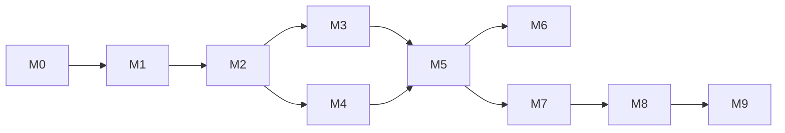

# Roadmap

> **Status:** Draft. Milestones are sequenced by dependency, not by calendar date. Dates are set only after M0 resolves the major external unknowns. A milestone is complete only when **all** completion criteria are met; partial completion is reported as such.

## Overview

| Milestone | Theme | Depends on |
| --- | --- | --- |
| **M0** | Foundations, external verification, business setup | — |
| **M1** | Platform skeleton: tenancy, auth, RLS, audit | M0 |
| **M2** | Google integration and device inventory | M1, M0 Google spike |
| **M3** | Command engine with Google commands | M2 |
| **M4** | Policy engine (read, limited write, drift) | M2 |
| **M5** | Security events, retention, MVP hardening and launch gate | M3, M4 |
| **M6** | SchoolOS Chrome extension (classroom and filtering features) | M5, extension verification, privacy review |
| **M7** | Device gateway and Go agent alpha (Linux) | M5 |
| **M8** | Agent beta: policy enforcement and signed commands on Linux | M7 |
| **M9** | SchoolOS Linux educational OS pilot | M8 |

---

## M0: Foundations and external verification

**Goal:** Remove the largest unknowns before writing product code.

Scope:
- This documentation set, reviewed and accepted.
- Company-owned accounts: GitHub org, cloud provider, Google Cloud project(s), domain, email. **No production on personal or home infrastructure.**
- Acquire a Google Workspace for Education test tenant with ≥ 3 Chromebooks and valid device upgrade licenses.
- Execute the verification spike in [`CHROMEOS_INTEGRATION.md` §9](CHROMEOS_INTEGRATION.md#9-verification-plan-m0-spike). Throwaway scripts live outside the main codebase or in a clearly marked `spikes/` folder and are not production code.
- Start Google OAuth app verification and investigate partner programs and API terms.
- Engage education-privacy counsel; begin DPA template.
- Choose cloud provider and IdP (ADR). **Done 2026-11-02:** AWS `us-east-2` ([ADR-0018](DECISIONS/0018-aws-infrastructure-and-deployment.md)); Supabase Auth for identity and TOTP only ([ADR-0013](DECISIONS/0013-database-hosting-postgres-version-uuid-pooling.md), [ADR-0016](DECISIONS/0016-session-model.md)).

Completion criteria:
- [ ] All [Verified-Docs] items needed for M2–M3 are either [Verified-Tenant] or explicitly re-scoped.
- [ ] Google auth model decided (ADR written).
- [ ] OAuth verification requirements known (timeline, scopes classification).
- [ ] Counsel engaged; list of required legal deliverables for launch.
- [x] Cloud provider chosen (AWS, ADR-0018).
- [ ] AWS accounts created (Organizations; dev/staging/prod) with MFA on all human access and budgets/alerts configured before any workload.

Risks: Google verification lead time; device licensing cost; partner-program requirements gate access.

## M1: Platform skeleton

**Goal:** Secure multi-tenant foundation with no device features. Requires no Google API access.

Detailed plan: [`M1_IMPLEMENTATION_PLAN.md`](M1_IMPLEMENTATION_PLAN.md). Pre-M1 findings: [`ARCHITECTURE_READINESS_REVIEW.md`](ARCHITECTURE_READINESS_REVIEW.md). The cloud provider is decided (AWS, ADR-0018). Staging infrastructure still depends on the IaC tool (T-16) and egress design (T-17); all other M1 work does not. Application foundation (plan step 1) is implemented; M1 as a whole is not complete.

Scope:
- Next.js + TypeScript app, worker entrypoint, PostgreSQL migrations, local Docker Compose for DB.
- Organizations, schools, users, memberships, roles/permissions, school scopes.
- Supabase Auth behind `AuthProvider` interface; MFA enforcement.
- Tenant context + RLS on all tables; `authorize()` function and permission matrix.
- Audit log with hash chain and verification job.
- CI: type check, lint, tests, isolation tests, secret scan, dependency scan.
- Infrastructure as code for `dev` and `staging`.
- OpenAPI generation.

Completion criteria:
- [ ] Cross-tenant test suite passes for every table and route.
- [ ] No-context queries return zero rows (tested).
- [ ] Audit `UPDATE`/`DELETE` blocked for app role (tested).
- [ ] Staging deployed via pipeline, not manually.
- [ ] Threat model reviewed for M1 surface.

## M2: Google integration and inventory

Scope:
- Integration connect/disconnect flow (per M0 ADR).
- Encrypted credential storage (envelope encryption).
- Org-unit sync and mapping to schools.
- Device inventory full + on-demand sync; provenance timestamps; allow-listed fields.
- Device list, search, detail UI.
- Integration health page.

Completion criteria:
- [ ] Inventory count and key attributes match Google Admin console for the test tenant.
- [ ] Disconnect revokes credentials and halts sync within 5 minutes.
- [ ] No credentials appear in logs (automated log scan in tests).
- [ ] Sync handles pagination, quota errors, and partial failures with retries.

## M3: Command engine

Scope:
- Command model, lifecycle, `command_events`, idempotency, expiry.
- Approval workflow and step-up auth.
- Google commands: `REBOOT`, `WIPE_USERS`, `REMOTE_POWERWASH`; status changes `DISABLE`, `REENABLE`, `DEPROVISION` (chunked ≤ 50).
- Status polling and mapping to SchoolOS states.
- Bulk caps, rate limits, kill switch.
- Command history UI with live state.

Completion criteria:
- [ ] Each command type exercised against a real test device with recorded state transitions.
- [ ] Powerwash/deprovision blocked without second approver (tested).
- [ ] Requester cannot self-approve (tested).
- [ ] Kill switch stops dispatch within one job cycle (tested).
- [ ] UI never shows success without provider confirmation (reviewed + tested).

## M4: Policy engine

Scope:
- Setting catalog with ≥ 5 settings mapped to Chrome Policy schemas confirmed via `policySchemas.list`.
- Policy versions, assignments, deployments with per-target results.
- Preview via `policies.resolve`; apply via `orgunits.batchModify`.
- Drift detection job and drift events.
- "Not enforceable on this platform" handling.

Completion criteria:
- [ ] Applied settings visible in Google Admin console for target OU.
- [ ] Manual Admin console change detected as drift within one cycle.
- [ ] Unsupported setting/target combos recorded as `not_applicable`, never `applied`.

## M5: Security events, retention, MVP launch gate

Scope:
- Deterministic rules: dev mode boot, OS non-compliance, device status change to disabled/deprovisioned outside SchoolOS, policy drift, auth anomalies.
- Triage UI and notes.
- Retention settings and purge jobs; data-subject request workflow; offboarding.
- Data & Monitoring transparency page.
- Support access grants.
- Production environment, backups/PITR, monitoring and alerting, on-call.
- External penetration test.
- Legal deliverables (terms, privacy policy, DPA) approved by counsel.

Completion criteria:
- [ ] All MVP acceptance criteria in PRODUCT_REQUIREMENTS §7 pass in staging against a real test tenant.
- [ ] Pen test high/critical findings remediated.
- [ ] Restore-from-backup drill completed within RTO.
- [ ] Incident response tabletop exercise completed.
- [ ] Counsel sign-off on launch materials (no compliance claims beyond what counsel approves).

**MVP launch = M5 complete.** First pilot district onboarded only after M5.

## M6: SchoolOS Chrome extension

Scope (subject to verification and privacy review; may be reduced):
- Extension built in-house, force-installed via policy.
- Strong extension authentication (research outcome from OPEN_QUESTIONS).
- Device gateway v0 for extension traffic.
- Candidate features: SchoolOS-native URL filtering, extension heartbeat/tamper detection, teacher classroom tools (only if verified and approved).

Completion criteria:
- [ ] Each feature verified on real devices; limitations documented.
- [ ] Privacy review completed; transparency indicators implemented.
- [ ] Extension cannot be removed by student in test tenant (verified).
- [ ] Extension authentication resists replay and spoofing (tested).

## M7: Device gateway and Go agent alpha

Scope:
- Device gateway with mTLS, enrollment tokens, device CA.
- Go agent: enroll, heartbeat, inventory report, signed command verification, `reboot` executor.
- Signed agent releases and update channel.
- Supported on one mainstream Linux distribution for development.

Completion criteria:
- [ ] Agent enrolls with single-use token; replayed token rejected.
- [ ] Forged, expired, replayed, and wrong-device commands rejected (automated tests).
- [ ] Revoked certificate cannot connect.
- [ ] Command lifecycle visible in the same UI as Google commands.

## M8: Agent beta, Linux enforcement

Scope:
- Policy executors (e.g. network filtering, USB restrictions, update enforcement): exact list decided by ADR.
- Offline policy enforcement and event queueing.
- Self-update with rollback.
- Tamper detection (heartbeat gaps, integrity checks).

Completion criteria:
- [ ] Each enforcement verified on real hardware; limitations documented.
- [ ] Update rollback tested.
- [ ] Independent security review of agent.

## M9: SchoolOS Linux educational OS pilot

Scope:
- Base OS image with verified boot, agent as protected system service, managed updates.
- Enrollment flow for SchoolOS Linux devices.
- Pilot with one school on a limited fleet.

Completion criteria:
- [ ] Verified boot chain documented and tested on target hardware.
- [ ] Agent cannot be disabled by a non-admin user (tested).
- [ ] Pilot feedback captured; go/no-go decision recorded.

---

## Cross-cutting risks

| Risk | Impact | Likelihood | Mitigation |
| --- | --- | --- | --- |
| Google API access requires a partner program or lengthy verification | Delays M2–M3 | Medium | Start in M0; build against test tenant; keep provider adapter boundary |
| Key Google capabilities are narrower than assumed (e.g. commands limited to kiosk) | Reduced MVP value | Medium (some already confirmed) | Verified capability registry; honest UI; prioritize native agent long-term |
| Legal/privacy requirements expand scope | Delays launch | Medium | Counsel engaged in M0; data minimization by default |
| Cross-tenant data leak | Existential | Low if controls hold | RLS + app authz + tests + pen test |
| Small team over-scoping | Missed milestones | High | Strict MVP scope; ADRs for additions |
| Competitor IP / non-compete concerns (e.g. team members' prior employers) | Legal | Unknown | Counsel review; clean-room development; no competitor code or docs |
| Device licensing costs for test fleet | Budget | Medium | Minimal test fleet |
| Linux OS effort is very large | M9 slips | High | Treat M9 as strategic; agent on stock Linux delivers value earlier |
