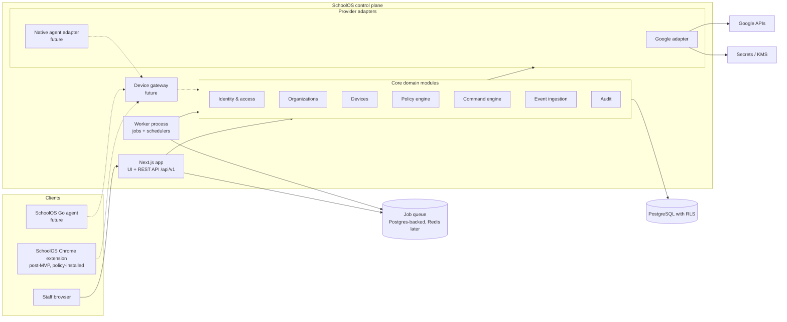
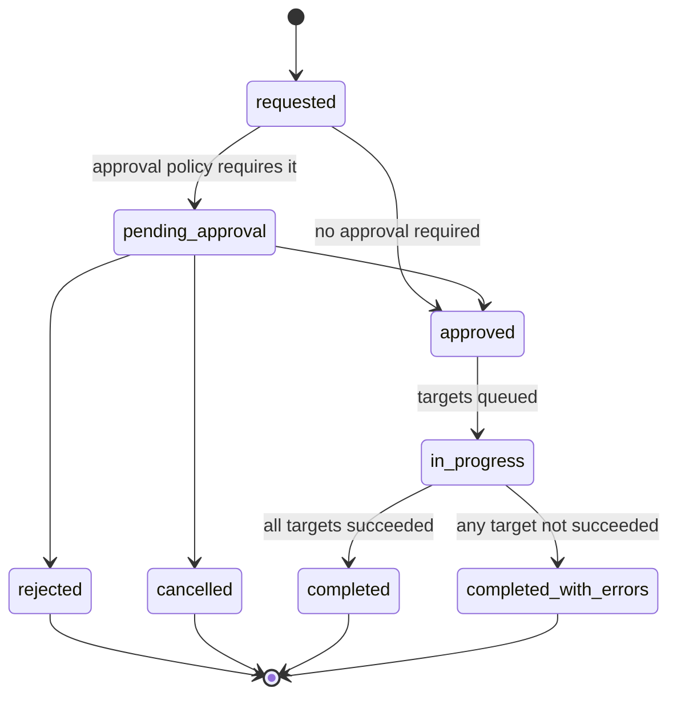
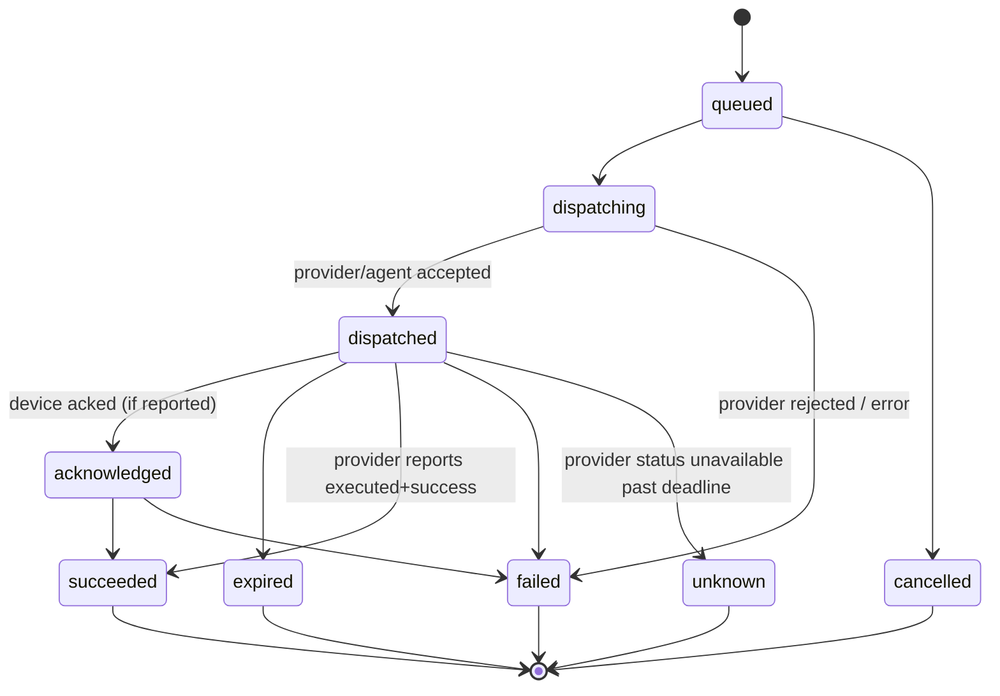
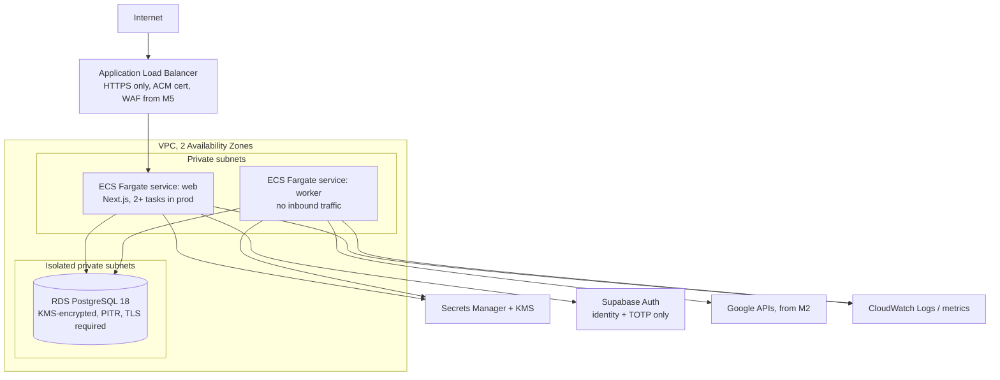

# System Architecture

> **Status:** Proposed. Changes to anything in this document that affect security, tenancy, or provider boundaries require an ADR in [`DECISIONS/`](DECISIONS/).

## 1. Architectural summary

SchoolOS is a **multi-tenant modular monolith** for the MVP:

- One **Next.js (TypeScript)** application serving the staff web UI and a versioned REST API.
- One **worker process** (same codebase, different entrypoint) running background jobs: provider sync, command dispatch, status polling, retention purges.
- **PostgreSQL** as the single system of record, with row-level security on every tenant-scoped table.
- **Provider adapters** (Google first) isolated behind internal interfaces so the core domain never depends on Google-specific types.
- A future **device communication gateway** for native Go agents and the SchoolOS extension, added when those clients exist.



## 2. Guiding principles

1. **Multi-tenant from day one.** Tenant ID (`organization_id`) is on every tenant-scoped row and in every request context.
2. **Defense in depth for authorization.** Application-layer permission checks *and* PostgreSQL RLS. Either alone must be sufficient to block cross-tenant access.
3. **Control plane vs. integrations.** The core models intent (policies, commands) and observed state (devices, events). Providers translate intent into platform calls and report observations back.
4. **Truthful state.** Intended state, dispatched state, and confirmed state are separate fields. The UI only reports what a provider or agent confirmed.
5. **No premature microservices.** Module boundaries are enforced in code (lint rules on imports), not by network boundaries.
6. **Everything important is a job.** Provider calls are made from workers, not from HTTP request handlers, so they can be retried, rate-limited, and audited.

## 3. Multi-tenancy model

- **Tenant = Organization** (typically a school district). Schools are sub-scopes inside a tenant, not separate tenants.
- **Shared database, shared schema**, isolated by `organization_id` + RLS. This is the simplest model that scales to the MVP targets and supports strong isolation when done carefully.
- **Request tenant context:** each authenticated request resolves `(user_id, organization_id, roles, school_scopes)`. The database transaction sets `app.current_org_id` and `app.current_user_id` via `SET LOCAL` before any query. RLS policies read those settings.
- **Platform-level (cross-tenant) operations** (billing reports, operator tooling) run under a separate database role with explicit, audited access paths. They are never reachable from tenant-facing routes.
- **Future option:** large or regulated customers can be moved to a dedicated database (same schema) if contractually required. The adapter for DB connections is designed so this is a configuration change, not a rewrite.

See [`DATA_MODEL.md`](DATA_MODEL.md#4-organization-isolation-and-row-level-security) for the RLS pattern.

## 4. Frontend

- **Next.js App Router**, React Server Components where it simplifies data fetching; client components for interactive tables and forms.
- **Tailwind CSS** and **shadcn/ui** (components copied into and owned by the repo). Toolchain: pnpm, Node.js LTS (pinned), strict TypeScript, single Next.js app. See [ADR-0012](DECISIONS/0012-tooling.md).
- Org-scoped UI routes are `/o/{orgSlug}/...` ([ADR-0015](DECISIONS/0015-organization-resolution.md)).
- The browser holds no authentication tokens; only an opaque HttpOnly session cookie ([ADR-0016](DECISIONS/0016-session-model.md)).
- The UI calls **the same REST API** that external integrations will use (no hidden internal-only endpoints for core actions). Server components may call the service layer directly, but must go through the same authorization functions.
- Design requirements:
  - Every device attribute displays its source and freshness ("Google, 14 min ago").
  - Every command displays its live lifecycle state and provider response.
  - Settings that cannot be enforced on a platform are visibly disabled with an explanation.
  - Demo/sandbox organizations show a persistent "Simulated data" banner.
- Accessibility target WCAG 2.1 AA.

## 5. Backend

### 5.1 Layering

```
app/api/v1/**            HTTP handlers: parse, authenticate, call service, serialize
src/modules/<module>/    Domain services, validation, authorization checks
src/modules/<module>/db  Repository functions (SQL), always inside a tenant-scoped transaction
src/providers/<name>/    Provider adapters (Google today), implement provider interfaces
src/jobs/                Job definitions executed by the worker
src/platform/            Cross-cutting: config, logging, crypto, tenant context, errors
```

M1 step 1 implements `app/` (landing, status, `GET /api/v1/health`), `src/platform/config`, `src/platform/log`, `src/platform/http`, `src/platform/security`, `src/components`, and `src/worker.ts`. Domain modules, database access, auth, and providers are not created yet. See [`DEVELOPMENT.md`](DEVELOPMENT.md).

Rules:
- Handlers never contain business logic or SQL.
- Modules never import from `src/providers/*` directly; they depend on interfaces in `src/modules/<module>/ports.ts`, wired at startup.
- Only `src/platform/db` opens database connections, and it always sets tenant context. It holds one `pg.Pool` and one root Kysely instance; handlers receive only a Kysely `Transaction`. Application modules never create their own connections or query-builder instances ([ADR-0014](DECISIONS/0014-database-tooling.md)).

### 5.2 REST API

- Base path `/api/v1`. Resource-oriented, JSON, cursor pagination.
- Every mutating endpoint accepts an `Idempotency-Key` header; the API replay cache stores keys and responses per organization for 24 h. Separately, command creation records its key permanently on `commands.idempotency_key` (unique per organization) so a command can never be created twice.
- Errors use a consistent problem format (`type`, `title`, `status`, `detail`, `correlation_id`).
- An OpenAPI document is generated from the route schemas and checked into the repo from M1.
- Authentication: session cookie for the browser UI; scoped API tokens for machine clients (post-MVP).

### 5.3 Device communication layer (future)

REST is sufficient for the staff UI and Google integration. Native agents and the extension need:
- device authentication with per-device credentials (mTLS or signed tokens; see SECURITY_MODEL),
- low-latency command delivery (long-poll or WebSocket initially; gRPC/HTTP2 streaming evaluated for the Go agent),
- event upload with backpressure.

This is a separate **device gateway** process introduced in M6/M7. It shares the codebase and database access layer but has its own network ingress and authentication path, so device traffic cannot reach staff endpoints and vice versa.

## 6. Database

- **AWS RDS for PostgreSQL, major version 18**, in isolated private subnets in `us-east-2`. Local development and CI use the Docker official `postgres` image at the same pinned major and minor version ([ADR-0013](DECISIONS/0013-database-hosting-postgres-version-uuid-pooling.md)).
- **Supabase is not used as a database** and its generated Data API is not used. All SchoolOS data, including authorization data, lives in RDS.
- **UUIDv7 primary keys are generated in the application** with Node.js `crypto.randomUUIDv7()` through a centralized helper ([ADR-0020](DECISIONS/0020-uuidv7-node-crypto.md)); the schema doesn't depend on native PostgreSQL UUIDv7.
- **Connection pooling:** a standard `pg` `Pool` per process with direct private TLS connectivity to RDS. No RDS Proxy or external pooler until a measured need is recorded in an ADR, and only after the `SET LOCAL` and cross-tenant concurrency tests pass against it.
- **Tooling:** dbmate for plain SQL migrations, Kysely for typed queries, node-postgres for the pool and transactions. Direct SQL is kept for RLS, policies, triggers, functions, advisory locks, and audit operations ([ADR-0014](DECISIONS/0014-database-tooling.md)).
- Schema migrations are versioned SQL files, reviewed like code, applied by CI/CD, never by hand in production.
- RLS enabled and **forced** on all tenant-scoped tables. The working design is [ADR-0003](DECISIONS/0003-postgresql-multi-tenancy-rls.md), which remains **Proposed** and requires independent review before acceptance.
- Application connects as a non-owner role (`app_user`) that cannot bypass RLS. Migrations run as a separate owner role.
- Append-only tables (audit log, command state transitions) have `UPDATE`/`DELETE` revoked from `app_user`.
- Large/high-volume tables (security events, telemetry snapshots) are designed for time-based partitioning, introduced when volume requires.

## 7. Authentication

- **Staff identity:** Supabase Auth authenticates identity (email + password) and TOTP MFA. OIDC/SAML staff sign-in may be added later. It is wrapped behind an internal `AuthProvider` interface:
  - `verifySession(request) → { userId, authTime, mfa }`
  - `getUser(userId)`
  - `revokeSessions(userId)`
- **SchoolOS owns sessions.** An opaque `__Host-` HttpOnly session cookie maps to a SchoolOS `user_sessions` record that enforces a 30-minute idle timeout, a 12-hour absolute lifetime, MFA gating, fresh-MFA step-up, and revocation, independently of Supabase plan settings. Supabase tokens are verified server-side (JWKS signature with an asymmetric algorithm allow-list, `iss`, `aud`, `exp`, `aal`/`amr`) and stored server-side only, encrypted. They're never placed in browser storage ([ADR-0016](DECISIONS/0016-session-model.md), Proposed pending spike).
- **SchoolOS owns authorization.** Users, memberships, and roles live in SchoolOS tables, not in the identity provider's metadata. The IdP only answers "who is this?". Token claims such as `role`, `app_metadata`, and `user_metadata` are never used for authorization.
- Supabase-specific features (its database, generated Data API, client-side data access) are **not** used. All data access goes through our server. This keeps migration to another OIDC provider feasible.
- TOTP MFA is required for privileged organization roles; fresh MFA (≤ 5 minutes) for sensitive administrative operations. Details are in SECURITY_MODEL §5.

See [ADR-0004](DECISIONS/0004-authentication-provider.md) and [ADR-0016](DECISIONS/0016-session-model.md).

## 8. Authorization

- **Permission-based RBAC with scopes.** Roles map to permissions (e.g. `device.read`, `command.issue.reboot`, `command.approve`, `policy.write`, `audit.export`). A membership grants a role for an organization, optionally restricted to a set of schools.
- A single function `authorize(ctx, permission, resource)` is the only way handlers check permissions. It is unit tested with a permission matrix.
- The organization is explicit in every URL, and membership and permissions are re-verified on every request ([ADR-0015](DECISIONS/0015-organization-resolution.md)). SchoolOS support access, from M5, uses temporary grants evaluated by `authorize()` with no permanent membership ([ADR-0019](DECISIONS/0019-support-access-grants.md)).
- RLS enforces tenant isolation; school-scope filtering is enforced in the service layer and, for sensitive tables, also by RLS using a `app.current_school_ids` setting. In M1, school scope is enforced in the service layer only; RLS school scoping starts with device tables in M2.
- Deny by default. New endpoints fail a CI check if they do not declare a required permission.

## 9. Policy engine

**Purpose:** Turn a platform-neutral policy (intent) into provider-specific configurations, apply them, and detect drift.

- **Policy definition:** a versioned document of settings, each keyed by a SchoolOS setting ID (e.g. `device.developer_mode.block`).
- **Setting catalog:** a code-reviewed registry mapping each SchoolOS setting to its per-platform implementation:
  - `chromeos.google_policy`: a Chrome Policy API schema name and field (only schemas confirmed via `policySchemas.list` against a real tenant),
  - `chromeos.extension`: implemented by the SchoolOS extension (post-MVP),
  - `linux.agent`: implemented by the Go agent (future),
  - `unsupported`: explicitly not enforceable on that platform.
- **Targeting:** organization → school → device group. For ChromeOS, targets resolve to Google org units (and possibly groups where the Chrome Policy API supports them for that schema).
- **Deployment:** creates a `policy_deployment` with one `policy_deployment_target` per resolved provider target; executed by a worker job; results recorded per target.
- **Conflict rule (MVP):** most specific scope wins; conflicts within the same scope are a validation error.
- **Drift detection:** scheduled job calls the provider's resolve/read API and compares it with intended values; differences raise a `policy_drift` security event.
- **No silent acceptance:** if a setting maps to `unsupported` for a target platform, the deployment records `not_applicable` for that target. It is not reported as success.

## 10. Command engine

**Purpose:** Issue remote actions with a full, auditable lifecycle, independent of the provider.

### 10.1 Lifecycle

Approval happens once per **command** (one request, possibly many devices). Execution is tracked per **command target** (one device).

Command-level states (`commands.status`):



Target-level states (`command_targets.status`), created when the command is approved:



- Each target transition is an **append-only** row in `command_events` with timestamp, actor (user, system, provider, device), and raw provider payload reference. Command-level transitions (request, approval, rejection, cancellation) are recorded in `command_approvals` and the audit log.
- `command_targets.status` is a denormalized projection of that target's latest `command_events` row, updated in the same transaction. `commands.status` is an aggregate of its targets' statuses, recomputed in the same transaction as any target change.
- Provider mapping example (Google Directory API command states, verified in CHROMEOS_INTEGRATION): `PENDING → dispatched`, `SENT_TO_CLIENT → dispatched (sub-state sent)`, `ACKED_BY_CLIENT → acknowledged`, `EXECUTED_BY_CLIENT + SUCCESS → succeeded`, `EXECUTED_BY_CLIENT + FAILURE → failed`, `EXECUTED_BY_CLIENT + IGNORED → failed (reason: ignored by client)`, `EXPIRED → expired`, `CANCELLED → cancelled`.
- `unknown` exists so we never guess. If we lose track of a command, we say so.

### 10.2 Dispatch

- Commands are dispatched by worker jobs with per-organization and per-provider rate limits.
- Dispatch is idempotent: the job checks the command's current state and stored provider command ID before calling the provider.
- For Google commands, a polling job queries command status until a terminal state or deadline.
- For native agents (future), commands are **signed** by the control plane and verified by the agent (see SECURITY_MODEL).

### 10.3 Approvals and remote access

- Approval policies are per organization and per command type: `none`, `self_confirm` (re-auth), `second_approver`.
- The requester cannot approve their own request.
- Remote-access commands (e.g. Chrome Remote Desktop session) require a dedicated permission, a reason, step-up authentication, and are flagged in the audit log as remote-access events.

## 11. Event ingestion

- **Sources (MVP):** provider sync diffs (e.g. device switched to developer boot mode, OS version non-compliant, device status changed), SchoolOS internal events (failed login bursts, role changes, integration errors).
- **Sources (later):** Google telemetry events / notifications (pending verification), SchoolOS extension events, Go agent events.
- **Pipeline:** raw observation → normalized `security_event` with `source`, `rule_id`, `severity`, `entity_ref`, `provenance` → dedupe window → triage queue.
- Rules are deterministic and versioned in code. No ML.
- Raw provider payloads needed for provenance are stored with retention limits; fields not needed are dropped at ingestion (data minimization).

## 12. Integrations (provider adapters)

Each provider implements a set of narrow interfaces:

```ts
// Illustrative interface shapes, not final code.
interface DeviceInventoryProvider {
  listDevices(conn: IntegrationRef, cursor?: string): Promise<Page<ProviderDevice>>;
  getDevice(conn: IntegrationRef, providerDeviceId: string): Promise<ProviderDevice>;
}
interface CommandProvider {
  supportedCommands(): CommandCapability[];
  dispatch(conn: IntegrationRef, cmd: CommandIntent): Promise<DispatchResult>;
  getStatus(conn: IntegrationRef, providerCommandRef: string): Promise<ProviderCommandStatus>;
}
interface PolicyProvider {
  resolve(conn: IntegrationRef, target: ProviderTarget, keys: string[]): Promise<ResolvedPolicy>;
  apply(conn: IntegrationRef, target: ProviderTarget, changes: PolicyChange[]): Promise<ApplyResult>;
}
```

- `supportedCommands()` is the single source of truth for what the UI offers per platform. It must only list capabilities verified in CHROMEOS_INTEGRATION.
- Provider HTTP clients handle auth, retries with exponential backoff and jitter, quota errors, and record provider request IDs.
- Provider credentials are loaded via the secrets layer at call time and never logged.

## 13. Device agent architecture (future, M7+)

Applies to the SchoolOS native agent on our Linux-based OS and potentially other Linux distributions.

- **Language:** Go (single static binary, cross-compilation, strong standard library for TLS/crypto). See [ADR-0007](DECISIONS/0007-go-device-agent.md).
- **Components:**
  - `enroll`: one-time enrollment using an organization-scoped, short-lived enrollment token; generates a device key pair (in TPM where available), submits a CSR, receives a device certificate.
  - `transport`: mTLS connection to the device gateway; long-poll/stream for commands; batched event upload.
  - `verifier`: verifies command signatures, expiry, target device ID, and nonce before execution.
  - `executors`: one module per command type; each declares preconditions and returns a structured result.
  - `policy`: applies local policy (e.g. network filtering, USB controls) via OS-specific backends.
  - `reporter`: inventory and health snapshots.
  - `updater`: signed self-update with rollback.
- **Platform split:** core agent logic is OS-neutral; OS-specific code lives in `platform/<os>` packages behind interfaces.
- **Tamper resistance** relies on the OS (our own Linux OS can run the agent as a protected system service with verified boot); on general Linux it is best-effort and must be documented as such.
- **Offline behaviour:** last-known policy remains enforced; queued events are uploaded on reconnect; commands past expiry are rejected.

## 14. Deployment topology

### Environments

| Environment | Purpose | Data |
| --- | --- | --- |
| `local` | Developer machines (Docker Compose `postgres:18.x`, same pin as RDS) | Synthetic only |
| `test` (CI) | Automated tests (ephemeral Docker `postgres:18.x`) | Synthetic only |
| `dev` | Shared integration testing (AWS `dev` account) | Synthetic + a dedicated Google test tenant (from M2) |
| `staging` | Pre-production, production-like config (AWS `staging` account) | Synthetic + Google test tenant; no customer data |
| `production` | Customers (AWS `prod` account) | Customer data |

### Production topology (MVP): AWS `us-east-2`

See [ADR-0018](DECISIONS/0018-aws-infrastructure-and-deployment.md) for the full decision, including account structure, network layout, and cost controls.



- **Production must run on managed cloud infrastructure under a company-owned account**, never on a developer's home server, homelab, or personal cloud account. See [ADR-0011](DECISIONS/0011-production-infrastructure-separation.md).
- **Cloud provider: AWS, region `us-east-2`.** Web and worker run as independent ECS Fargate services from one container image. RDS sits in isolated private subnets with no public access. Secrets are in AWS Secrets Manager and encryption keys in AWS KMS.
- Separate AWS accounts per environment (AWS Organizations); human access via IAM Identity Center with MFA; CI deploys via GitHub Actions OIDC roles. No static cloud keys.
- Infrastructure as code from M1 (tool: OPEN_QUESTIONS T-16); no click-ops in staging or production.
- **Cost control:** AWS Budgets with alerts and Cost Anomaly Detection in every account, mandatory cost tags, and no unnecessary always-on resources during development (dev scaled to zero or stopped when idle, destroyable from IaC). See ADR-0018.
- Database migrations run as a one-off ECS task in the deploy pipeline, not at app startup.
- CI/CD: tests, type checks, lint, dependency and secret scanning on every PR; production deploys from `main` via a protected pipeline with manual approval.
- Redis is introduced only when a concrete need appears (rate limiting across many instances, high-volume queues, pub/sub for live UI). See [ADR-0009](DECISIONS/0009-background-jobs.md).

## 15. Observability

- Structured JSON logs with `correlation_id`, `organization_id`, `actor_id`; PII redaction at the logger. Shipped to CloudWatch Logs with an explicit retention period per log group.
- Metrics: request latency, job queue depth, provider error rates by code, command state durations.
- Alerting on: provider auth failures, sync failures per org, command stuck in `dispatching`, RLS policy violations (errors), audit chain verification failures.

## 16. Explicitly deferred

- Separate services for commands, events, or policies.
- Event streaming platforms (Kafka, etc.).
- GraphQL.
- Multi-region active-active.
